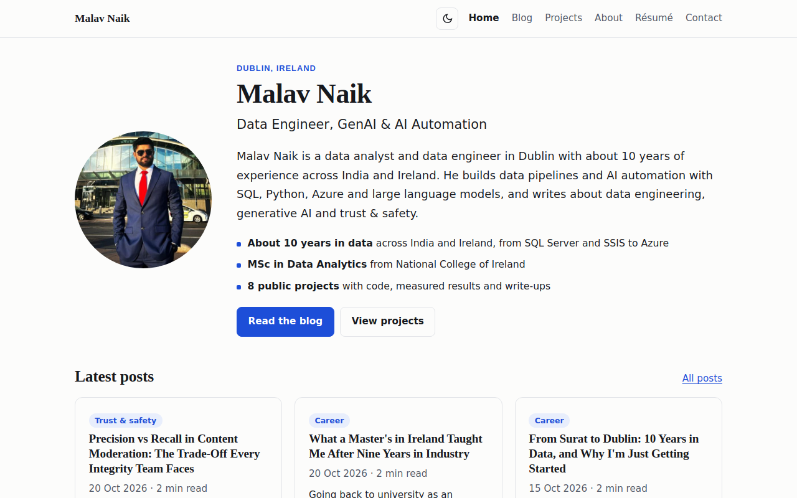

# malavnaik.com

Source for **[malavnaik.com](https://malavnaik.com)**, the personal site and blog of Malav Naik, a data engineer in Dublin, Ireland, working on data pipelines, GenAI and AI automation.

[](https://malavnaik.com)

The site has:

- **[Work](https://malavnaik.com/work/)**: case studies covering the problem, the approach, measured results, the stack and the code.
- **[Writing](https://malavnaik.com/writing/)**: posts on data engineering, generative AI and trust & safety, grouped into series.
- **[About](https://malavnaik.com/about/)**, **[Résumé](https://malavnaik.com/resume/)** and **[Contact](https://malavnaik.com/contact/)**.

## Tech stack

| Area | What it uses |
|---|---|
| Site generator | [Jekyll](https://jekyllrb.com/), with layouts and includes written by hand and no theme |
| Hosting | GitHub Pages, built and deployed by a GitHub Actions workflow ([`static.yml`](.github/workflows/static.yml)) |
| Domain | `malavnaik.com` with Cloudflare DNS and HTTPS |
| Front end | Semantic HTML, one inline stylesheet, light and dark mode, and a few lines of vanilla JavaScript ([`assets/site.js`](assets/site.js)) |
| SEO | `jekyll-seo-tag` (titles, Open Graph and Twitter cards), `jekyll-sitemap`, `jekyll-feed` (RSS) |
| Structured data | schema.org JSON-LD for Person, WebSite, BlogPosting and BreadcrumbList ([`_includes/schema.html`](_includes/schema.html)) |
| AI and answer engines | [`llms.txt`](llms.txt), a [`robots.txt`](robots.txt) that welcomes search and AI crawlers, and an optional TL;DR and FAQ on each post |
| Indexing | IndexNow, so Bing and other engines learn about each new post as soon as it is published |
| Analytics | [GoatCounter](https://www.goatcounter.com/): privacy-friendly and cookie-free |

Every build also checks that each image has alt text. The deploy fails if one doesn't.

## How blog posts are published

Posts aren't written in this repo. They are published by a small bot that needs a human tap before anything goes public:

1. Every Monday the bot sends previews of the next posts to Telegram.
2. Each post goes out only after a ✅ tap. The bot commits it to `_posts/` here, then cross-posts it to DEV and LinkedIn with a canonical link back to this site.
3. It updates the [Automation Lab](https://malavnaik.com/projects/blog-automation-bot/) numbers on the home page and pings IndexNow.

You can read how it works on the [project page](https://malavnaik.com/projects/blog-automation-bot/). The code for both approval bots is in [telegram-approval-bots](https://github.com/malavnaik99/telegram-approval-bots).

## Run it locally

You need Ruby 3.x.

```bash
gem install jekyll jekyll-seo-tag jekyll-sitemap jekyll-feed
jekyll serve
```

Then open <http://localhost:4000>. GitHub Pages builds the live site with the same plugins.

## Repository layout

```
_layouts/       page, post, project and series layouts
_includes/      schema.org JSON-LD, author box, cards, Automation Lab
_posts/         blog posts (added by the publishing bot)
_projects/      project case studies (a Jekyll collection)
_data/          blog series and the Automation Lab numbers
blog/           blog index, topics and series hub pages
assets/         site JavaScript
images/         photos and the social share image
permits-2025/   the Employment Permits 2025 dashboard (Chart.js)
docs/           README assets (not published)
```

The content (posts, photos and project write-ups) is © Malav Naik. Feel free to read the code and learn from it.
