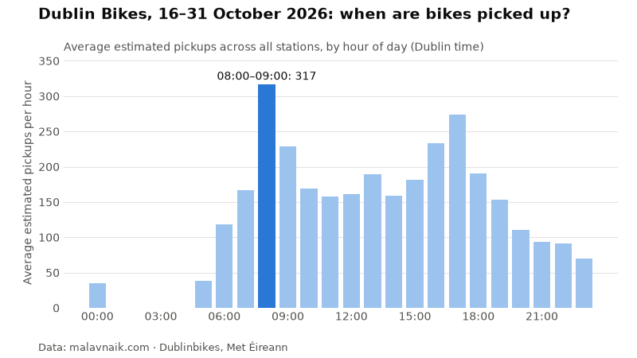

A monthly look at Dublinbikes, built from my [bikes and weather pipeline](/projects/dublin-bikes-pipeline/). This is the first edition. My pipeline started collecting on 16 October, so it covers **16–31 October 2026**.

**How I count pickups:** every 15 minutes I record how many bikes each station has, and whenever a station has fewer bikes than 15 minutes earlier, I count the difference as pickups, so the numbers are estimates (bikes moved by the rebalancing vans count too).

## The headline

About **48,783 estimated pickups** across 113 stations, or roughly 3,142 a day.

## The busiest hour

{: width="800" height="450"}

The busiest hour was **08:00–09:00**, with 317 estimated pickups on average across all stations.

## Busiest and quietest stations

Most estimated pickups:

1. Charlemont Place: 1,180
2. : 1,033
3. Princes Street / O'Connell Street: 888
4. Fownes Street Upper: 873
5. Exchequer Street: 780

Fewest:

1. Grangegorman Lower (Central): 72
2. Hardwicke Place: 141
3. Merrion Square South: 143
4. : 145
5. Kilmainham Lane: 150

## Where to find a bike

Average share of docks holding a bike. Emptiest stations:

1. : 4.5%
2. Hardwicke Place: 6.6%
3. Merrion Square South: 7.5%
4. Hatch Street: 8.5%
5. Eccles Street East: 9.8%

Fullest stations:

1. Dame Street: 81.2%
2. Smithfield North: 77.7%
3. Talbot Street: 74.7%
4. Barrow Street: 74.2%
5. Buckingham Street Lower: 72.9%

## What rain did

It rained (at least 0.1 mm at Dublin Airport) in 61 hours. In those hours there were **33.7% fewer estimated pickups** than in dry hours at the same time of day. Without adjusting for the time of day, rainy hours averaged 94 pickups and dry hours 162. Hours with only a trace of rain are left out. It's a small sample, so treat this as a first look.

Month-on-month comparisons start with the November edition.

## Use this data

You're welcome to reuse the chart in articles, slides or posts, as long as you link back to this post. The data behind it is open on Hugging Face: [raw snapshots](https://huggingface.co/datasets/Malavnaik/dublin-bikes-weather-raw) and [modelled tables](https://huggingface.co/datasets/Malavnaik/dublin-bikes-weather-marts), CC BY 4.0. Bikes: Dublinbikes GBFS feed, Dublin City Council / JCDecaux. Weather: Source: Met Éireann.

### Embed this chart

```html
<a href="https://malavnaik.com/blog/dublin-bikes-in-numbers-october-2026/"></a>
```
